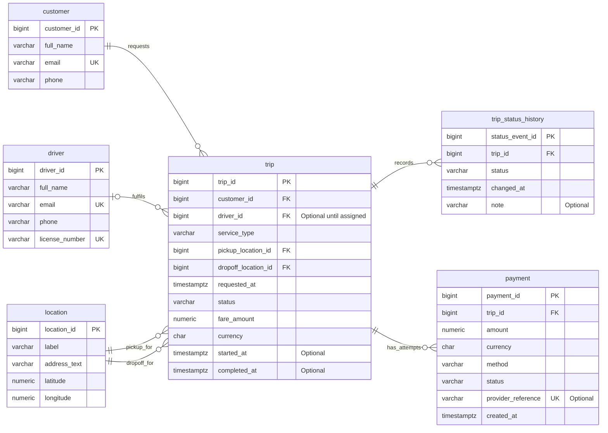

# Ride-hailing and Logistics ER Diagram

The diagram shows the core records and their relationships.

## Reading the diagram

- `PK` is a primary key; `FK` is a foreign key; `UK` is unique.
- `||` means exactly one, `o{` means zero or many, and `o|` means zero or one.
- Each trip has one customer, one pickup and one drop-off location. Its driver may be unassigned initially.
- Status history and payment attempts are separate child records, preserving multiple events/attempts for a trip.
- A partial unique database index enforces at most one successful payment per trip. The status-history/current-status synchronization is a transaction-level rule.
